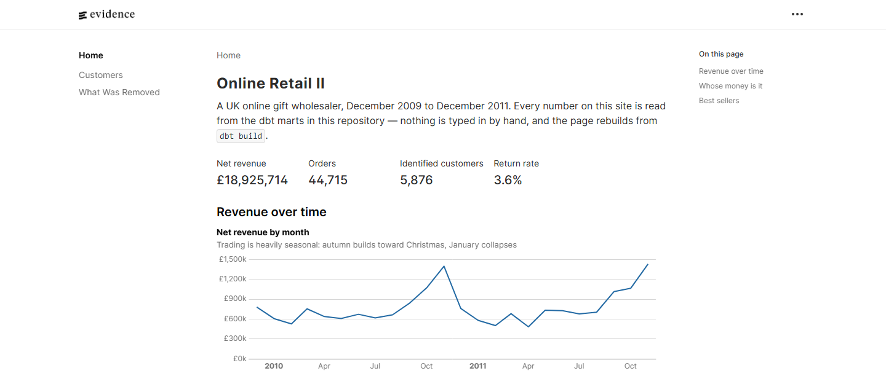
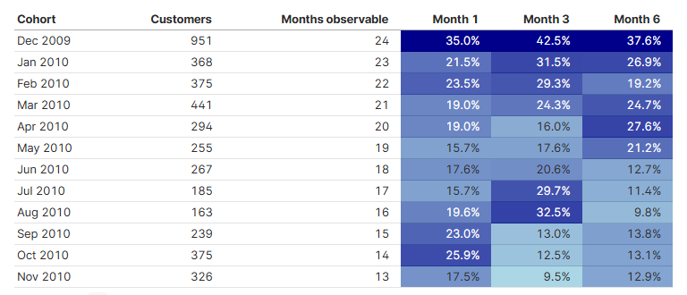

# retail-analytics — куда потратить бюджет на удержание?

[](https://github.com/diskaver-it/retail-analytics/actions/workflows/ci.yml) [](https://github.com/diskaver-it/retail-analytics/actions/workflows/deploy.yml)

**[Живой дашборд](https://diskaver-it.github.io/retail-analytics)** · [English version](README.md)

У британского оптовика подарков есть ограниченный бюджет на возврат клиентов, которые перестали
покупать. Маркетинг хочет потратить его на самую большую группу «уснувших». Этот репозиторий
строит склад, который проверяет, та ли это группа: 1 067 371 строка накладных из выгрузки UCI
**Online Retail II**, декабрь 2009 — декабрь 2011.

За публичным файлом 2011 года не стоит заказчик, поэтому вопрос я задал данным сам, а не получил
от бизнеса. Но это вопрос, на который эти данные действительно отвечают, и все числа ниже
посчитаны моделями из этого репозитория.

[](https://diskaver-it.github.io/retail-analytics)

## Ответ

**На 352 клиента, а не на 1 556.**

| RFM-сегмент | Клиентов | Выручка | Доля | На клиента | Медиана «молчания», дней | Заказов в среднем |
|---|---:|---:|---:|---:|---:|---:|
| Champions | 1 476 | £11 491 511 | 70.2% | £7 786 | 16 | 15.5 |
| Loyal | 1 244 | £2 426 811 | 14.8% | £1 951 | 74 | 5.3 |
| **At risk** | **352** | **£992 217** | **6.1%** | **£2 819** | **355** | **7.7** |
| Needs attention | 426 | £423 721 | 2.6% | £995 | 392 | 3.1 |
| **Hibernating** | **1 556** | **£633 523** | **3.9%** | **£407** | **432** | **1.3** |
| New | 455 | £235 422 | 1.4% | £517 | 28 | 1.5 |
| Promising | 323 | £157 812 | 1.0% | £489 | 81 | 1.3 |

Издалека оба «уснувших» сегмента выглядят одинаково — и те и другие не покупают больше полугода,
и тот, что крупнее, притягивает внимание. Он неверный.

Клиенты **At risk** сделали в среднем **7.7 заказа и принесли £2 819 каждый**, прежде чем замолчать.
Они доказали привычку покупать, а потом прекратили — вот об этом и стоит спросить их живым
человеком. Клиенты **Hibernating** сделали **1.3 заказа и принесли £407**. Возрождать нечего:
привычки не было, был первый заказ, который не повторился. Вчетверо больше людей ради денег,
которых втрое меньше.

Из тех же таблиц следуют ещё две вещи:

**При такой концентрации «удержание» — неправильное слово.** Топ-100 клиентов дают **36.8%
прослеживаемой выручки**, топ-10 — **16.3%**. Риск здесь не в оттоке вообще, а в уходе одного
конкретного аккаунта. Это работа с именованными клиентами, а не кампания, и бюджет ей нужен
не тот, о котором идёт спор.

**До восьмой части выручки маркетинг не дотянется в принципе.** У 243 007 строк (22.8%) нет
идентификатора клиента, и они несут **£2 567 652 — 13.6% чистой выручки**. Никакая программа
удержания их не достанет, потому что доставать некого. Если цель — повторные продажи, то
захват идентификации на кассе имеет потолок выше, чем любая кампания возврата против £992 217
выше. И это изменение продукта, а не строка маркетингового бюджета.

### Что должно быть верно

Сегментация — отправная точка, а не приговор. Три вещи, которых она не знает:

- **Работает ли обзвон вообще.** Данные показывают, кому звонить, но ничего не говорят об отклике.
  Следующий шаг — холдаут: связаться со случайной половиной из 352, вторую не трогать и сравнить
  выручку за 90 дней.
- **Значит ли «молчит» — «потерян».** Это оптовик, и 355 дней могут быть циклом закупки, а не
  уходом. Разделить одно и другое можно распределением интервалов между заказами по клиентам.
- **Сколько клиент стоит впереди, а не позади.** `monetary` — это уже полученная выручка. Решению
  о бюджете нужна ожидаемая будущая ценность, а для неё нужна маржа, которой в этой выгрузке нет.

## Пайплайн

`download → land → warehouse → dbt → marts → dashboard`. Python двигает байты до
`raw.transactions`, дальше всё на SQL, а дашборд — это markdown.

```
ingest (python)        transform (dbt)         marts                    dashboard (evidence)
──────────────────     ─────────────────       ────────────────────     ────────────────────
UCI .xlsx              stg_transactions        fct_order_lines          Trading overview
 → parquet landing      (типизация + флаги,    dim_customer             Customers
 → raw.transactions      ничего не удаляется)  dim_product              What was removed
                                               dim_date
                                               mart_monthly_revenue
                                               mart_cohort_retention
                                               mart_rfm
```

**54 dbt-проверки и 25 Python-тестов, все зелёные.** В CI модели собираются на синтетическом
складе, поэтому на каждый пуш прогоняются все модели и все тесты, ничего не скачивая с
университетского сервера.

Как загрузилось, до всякого моделирования:

| | |
|---|---|
| Строк принято | 1 067 371 |
| Накладных | 53 628 |
| Уникальных клиентов | 5 942 |
| Уникальных артикулов | 5 304 |
| Окно | 2009-12-01 → 2011-12-09 |

После моделей — это уже другая совокупность: служебных строк и дублей нет, а клиенту нужна
хотя бы одна покупка, чтобы получить строку:

| | |
|---|---|
| Строк заказов | 1 027 054 |
| Заказов (без отмен) | 44 715 |
| Клиентов с покупкой | 5 853 |
| Чистая выручка | £18 925 714 |
| Повторных клиентов | 72.3% |

## Пять решений, о которых стоит спорить

### 1. Staging помечает, а не фильтрует

`stg_transactions` отдаёт ровно столько же строк, сколько в источнике, и dbt-тест
([assert_staging_drops_nothing.sql](transform/tests/assert_staging_drops_nothing.sql))
роняет сборку, если это перестанет быть правдой. Отмены, гостевые корзины, строки доставки
и дубли приходят булевыми колонками, а не исчезают в чьём-то `WHERE`.

Причина в том, что ранняя фильтрация нефальсифицируема. Когда строка исчезла, уже не понять,
итог мал потому, что бизнес мал, или потому, что её съел пайплайн. В виде колонок каждая витрина
вслух объявляет, какие строки ей нужны, и любое число сходится обратно к сырым данным.

### 2. Гости остаются в выручке и не попадают в удержание

Привычное сокращение — `WHERE customer_id IS NOT NULL` в начале анализа — стирает восьмую часть
выручки ещё до того, как кто-то задал вопрос.

Поэтому знаменатели намеренно разные: выручка считается по всем строкам, удержание — только по
клиентам, которых можно проследить во времени. Гостей в `dim_customer` быть не может: без
идентификатора нельзя понять, две гостевые корзины — это один человек дважды или два человека
по разу.

### 3. Почта — не товар

62 артикула — это собственная бухгалтерия магазина: `POST`, `DOT`, `BANK CHARGES`, `AMAZONFEE`,
`ADJUST`, `M` для ручных правок. 6 093 строки на **−£95 225** нетто. Деньги двигают, но их никто
не заказывал, и график «топ товаров», который их оставляет, ставит на первое место доставку.

Правило — это *форма* кода, а не список руками: настоящий артикул — пять цифр с необязательной
буквой (`85123A`, `22633`). Рядом с ними **34 337 строк (3.2%)** — побайтовые дубли. И то и другое
удаляется один раз, в `fct_order_lines`, и больше нигде.

### 4. Последний месяц — обрыв, и модель это говорит

Выгрузка кончается 9 декабря 2011 года. Поэтому декабрь показывает **−69.1% к ноябрю и 28.3%
возвратов**: возвраты ноябрьских заказов попадают в декабрь, а собственных декабрьских заказов
почти ещё нет. Ничего не сломалось — просто кончился файл.

`mart_monthly_revenue.is_partial_month` помечает это, чтобы дашборд мог скрыть месяц. Та же идея
в `mart_cohort_retention.months_observable`: когорта, купившая впервые в прошлом месяце, ещё не
имела шанса вернуться, и без этой колонки график рисует её 0% рядом с настоящим 0% когорты
2009 года, как будто это одно и то же.

### 5. Давность считается от данных, а не от сегодня

`mart_rfm` считает recency от последнего дня выгрузки. Относительно `current_date` каждый клиент
в файле 2011 года одинаково и бесполезно «протух», все пять квинтилей схлопываются в один, и
сегментация выше не говорит вообще ничего. Всё, что зашивает «сейчас» константой, ломается так же
в тот момент, когда данные перестают быть живыми.

Границы 5×5 — это общепринятая условность, а не что-то выведенное из этого бизнеса; так и написано
в модели, потому что сегментация, поданная как факт, хуже сегментации, поданной как отправная точка.

## Находка, которую вытащили тесты

Первая сборка на реальных данных упала: у 87 строк факта был `customer_id`, которому нет
соответствия в `dim_customer`.

Это оказался не баг. **23 клиента присутствуют только как возвраты** — 87 строк, −£1 406, самая
ранняя в первый же день файла. Они купили *до* 2009-12-01, за пределами окна, а вернули товар
внутри него. Без покупки у них нет когорты, поэтому строки в `dim_customer` у них верно нет.

Тест на связь сузили до строк-покупок, а объяснение закрепили отдельным тестом
([assert_missing_customers_only_ever_returned.sql](transform/tests/assert_missing_customers_only_ever_returned.sql)):
в тот день, когда из `dim_customer` пропадёт клиент с настоящей покупкой, сборка упадёт, а не
даст недостаче тихо расползтись по всем клиентским метрикам.

Удержание падает не так, как у потребительского продукта: когорта декабря 2009 полгода держится
между 33% и 42% в месяц, а месяц 3 (42.5%) выше месяца 1 (35.0%) — это сезонный дозаказ, а не
протечка. Эта когорта к тому же выброс по построению: это не новые клиенты, а существующая база
магазина, впервые появившаяся в день начала выгрузки.



Колонка `months_observable` едет с каждой строкой по причине из решения 4: когорта, впервые
купившая за три месяца до конца выгрузки, ещё физически не может иметь числа за месяц 6,
и пустая клетка — не ноль.

## Дашборд

Три страницы на [Evidence](https://evidence.dev) — весь дашборд это markdown и SQL в `dashboard/`,
поэтому он читается и ревьюится диффом, как остальной репозиторий, а не лежит бинарником,
который никто не откроет.

- **Trading overview** — ключевые цифры, выручка по месяцам и разделение денег на те, что можно
  связать с клиентом, и те, что нельзя.
- **Customers** — когортное удержание и RFM-сегменты, на которых стоит рекомендация, с оговорками
  на самой странице, а не в сноске.
- **What was removed** — строки, которые пайплайн выбросил, и аргументы, почему.

Третья страница — необычная. Она нужна потому, что каждая цифра на двух других зависит от неё:
читатель, который не видит выброшенного, не может судить об оставшемся.

GitHub Actions пересобирает склад, прогоняет `dbt build`, собирает сайт и публикует его на Pages
на каждый пуш в `main`.

## Как запустить

```bash
pip install -e ".[dev]" "dbt-duckdb>=1.9"
```

Скачать данные и собрать склад — около 45 МБ с UCI, потом несколько минут разбора:

```bash
python -m retail_analytics all
```

Затем модели:

```bash
cd transform && DBT_PROFILES_DIR=. dbt deps && DBT_PROFILES_DIR=. dbt build
```

И дашборд, который читает только что собранный склад:

```bash
cd dashboard && npm install && npm run sources && npm run dev
```

Поднимается на <http://localhost:3000/retail-analytics> — base path выставлен под GitHub Pages
и действует в том числе локально.

Тесты, офлайн, данные не нужны:

```bash
pytest
```

Собрать модели, ничего не скачивая, — так делает CI:

```bash
python -m retail_analytics synthetic --warehouse data/ci.duckdb
```

### Заметки

- `profiles.yml` лежит в `transform/`, а не в `~/.dbt`, чтобы клон запускался без настройки.
  Секретов в нём нет, DuckDB — это файл. Переставить путь можно через `RETAIL_DUCKDB`.
- На Windows `dbt.exe` ставится вне `PATH`: звать по полному пути или через
  `python -m dbt.cli.main`.
- Книга Excel никогда не держится в памяти целиком. Сначала были испробованы три более коротких
  реализации — pandas с openpyxl, pandas с calamine и `read_xlsx` в DuckDB — и все три умерли с
  `MemoryError`, потому что каждая материализует лист целиком (больше полумиллиона строк), прежде
  чем что-то вернуть. `ingest.py` читает построчно и пишет parquet по одной row group: медленнее,
  зато доходит до конца.
- `evidence build` хочет больше 1.5 ГБ кучи Node. Поэтому production-сборка живёт в CI, а локально
  цикл — `npm run dev`; если всё же собирать локально, поднять лимит через
  `NODE_OPTIONS=--max-old-space-size=4096`.

## Источник

Chen, D. (2019). *Online Retail II*. UCI Machine Learning Repository.
<https://archive.ics.uci.edu/dataset/502/online+retail+ii>
